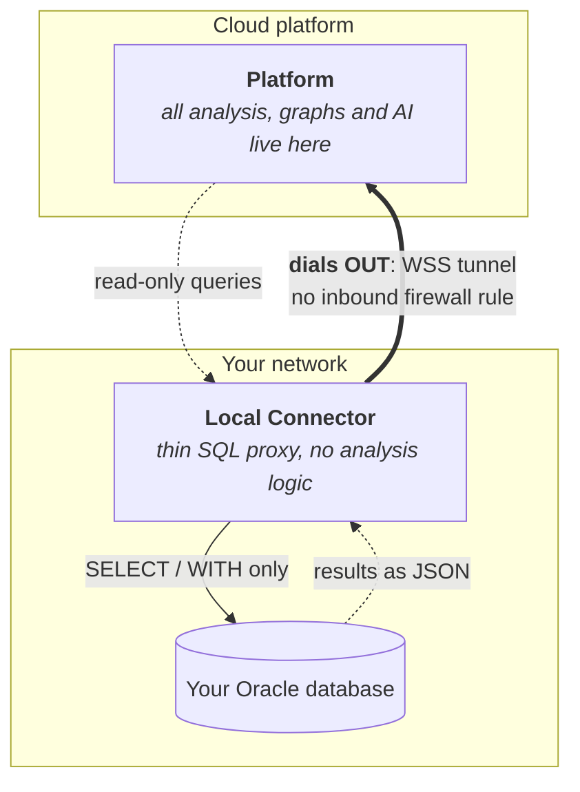

# Installing and running the agent

This is the guide for the person installing the agent inside their own network.
It ships in every release archive, next to the binary.

The agent is a **thin SQL proxy**: it connects your on-premises Oracle database
to the cloud platform. It contains no analysis logic, so all analysis, graph
building and AI processing happens in the cloud, and the agent only forwards
read-only queries and their results.

---

## How it works



The agent:

1. Opens an **outbound** WebSocket connection to the platform over TLS
   (`wss://`), so no inbound firewall rule is needed.
2. Receives read-only SQL queries from the platform.
3. Runs them on your Oracle database.
4. Sends back the rows, as JSON.

---

## Supported database connections

The agent connects to Oracle databases, over a direct network connection to a
listener the machine running the agent can already reach.

**Supported today**

- **The database is identified in one of two ways**, the agent's "Connect By"
  choice:
  - **Service name.** Hostname or IP, port, and the service name of a database
    or pluggable database (for example `ORCLPDB1`).
  - **SID.** Hostname or IP, port, and the SID of a legacy instance or
    Oracle XE (for example `XE`).
- **Authentication is always an Oracle database user and password**, entered
  once in the agent's local web UI. A dedicated read-only user is the
  recommended choice (see the Oracle user setup example below).
- **One agent can serve several databases.** Each connection is its own
  profile, with its own credentials and its own token, and each database is
  read in its own character set.
- **Oracle Database 11g Release 2 (11.2) and later.** Tested with 11.2, 12.2,
  18c, 19c, 21c, 23ai and 26ai. 12.1 is expected to work and has not been
  tested.

**Not supported yet**

- TNS aliases from `tnsnames.ora`, and raw connect descriptors
- Pasting a connection string, a JDBC URL from SQL Developer or DBeaver for
  instance. The database behind it is reachable: type its host, port and service
  name or SID into the form
- TCPS (encrypted listener) with an Oracle Wallet, the usual way to reach
  Autonomous Database on OCI
- A database that sets `SQLNET.ALLOW_WEAK_CRYPTO_CLIENTS=FALSE`, which refuses
  the agent's network encryption (see [Network encryption to the database](#network-encryption-to-the-database))
- LDAP or OID directory resolution
- Kerberos, operating-system, and other external authentication
- Connecting as SYSDBA or SYSASM
- A database whose character set is ZHS32GB18030 (a rare Simplified Chinese
  encoding; Chinese-language databases usually run AL32UTF8 or ZHS16GBK, which
  work). The Oracle driver the agent is built on (go-ora) has no conversion for
  it and refuses the connection
- Oracle Database releases before 11.2

The agent is the only component that talks to Oracle, so support for other
connection types can arrive in a later agent release without a change to the
cloud platform or to how you install the agent. Which Oracle releases work is
decided by the platform as well, because the queries the agent runs come from
it.

---

## Download

Download the latest release from the agent's **public repository**, which
holds both the source and the release binaries. The platform links to it
wherever the agent is mentioned: the onboarding steps, the token window on the
Connections page, and the Help page.

Pick the archive for your platform:

| Platform | Archive |
|---|---|
| Windows (most PCs and servers) | `db-agent_<version>_windows_amd64.zip` |
| Windows on ARM | `db-agent_<version>_windows_arm64.zip` |
| Linux (x86-64) | `db-agent_<version>_linux_amd64.tar.gz` |
| Linux (ARM64) | `db-agent_<version>_linux_arm64.tar.gz` |
| macOS (Apple Silicon) | `db-agent_<version>_darwin_arm64.tar.gz` |
| macOS (Intel) | `db-agent_<version>_darwin_amd64.tar.gz` |

Each archive holds the binary (`db-agent.exe` on Windows, `db-agent`
elsewhere), this guide, and the license files. The binary is a single file
with nothing else to install.

**Optional: check the download before you run it.** Each release publishes a
`checksums.txt`, and each archive has a signed build provenance attestation
recording the commit and the workflow that built it in the agent's public
repository.

```bash
# The archive is intact (Linux; the archive and checksums.txt in one folder)
sha256sum --ignore-missing -c checksums.txt

# The archive was built from the public source (any platform, GitHub CLI)
gh attestation verify db-agent_<version>_linux_amd64.tar.gz --repo schemaxis-com/local-connector
```

On macOS, `shasum -a 256 <archive>` prints the SHA-256, and on Windows
`Get-FileHash <archive>` does: compare it with the line for that file in
`checksums.txt`. `schemaxis-com/local-connector` is the public repository the download
link points to. An attestation check against any other repository fails, which
is how you tell the official build from a copy published elsewhere.

`gh attestation verify` runs only once the GitHub CLI is signed in to a GitHub
account, and any account will do: run `gh auth login` once before it. The
SHA-256 check needs no account.

**The binaries are not code-signed yet.** On first run, Windows SmartScreen
may say it protected your PC: choose **More info**, then **Run anyway**. macOS
may refuse to open a binary downloaded through a browser: allow it under
**System Settings → Privacy & Security**, or remove the download mark with
`xattr -d com.apple.quarantine db-agent`. Check the download as above first.

---

## First start

**Windows:** double-click `db-agent.exe`, or run it from a terminal.
**Linux and macOS:** run `./db-agent` from a terminal.

On its first start, the agent:

1. Creates its data directory: `%APPDATA%\<AppName>\` on Windows,
   `~/.<appname>/` on Linux and macOS, where `<AppName>` is the product name
   shown in the agent's window title.
2. Generates a local AES-256 encryption key (`.agent.key`) in that directory.
   It never leaves your machine.
3. Finds a free port, starting from `8088`.
4. Opens your default browser at `http://localhost:<port>`.

Then add a connection with **Add Connection**:

- **Tunnel URL** and **Agent Token**: copy them from the platform, where they
  appear as `TUNNEL_URL` and `AGENT_TOKEN`: in the onboarding steps, and on the
  Connections page under Get Token or View Token.
- **Hostname, Port, Service Name or SID, Username, Password**: the Oracle
  database as this machine reaches it.

**Test Database Connection** checks the login without saving anything. **Save
Connection** stores the profile, with the password and the token encrypted, and
starts the tunnel when "Enable and connect tunnel immediately" is ticked. Each
connection's card then shows its status.

```
db-agent.exe
        ↓
Browser opens at http://localhost:8088
        ↓ (Add Connection, fill in the form, Save Connection)
Tunnel connects over WSS to the platform
```

**Closed the browser tab by mistake?** Run the agent again. Only one agent
runs at a time, so a second launch finds the one already running, reopens its
web UI in your browser and exits. You do not need the port number, and the
agent keeps running. Started with `--no-browser`, the second launch prints the
address instead of opening it. If the agent was stopped by force or the
machine lost power, the next launch starts normally.

---

## Running on a server without a desktop

The same binary runs unattended on a machine with no desktop session: the
connection manager is a web UI served over HTTP, not a native window, so
nothing in the agent needs a display. Pass `--no-browser` so it does not try to
open one:

```bash
./db-agent --no-browser
```

The agent loads every enabled profile from `connections.json`, decrypts the
credentials with the local `.agent.key`, and opens the tunnels. The web UI is
still served, on loopback. To set up the profiles, either:

- reach that web UI from your own computer through an SSH tunnel, for example
  `ssh -L 8088:localhost:8088 <user>@<server>`, then open
  `http://localhost:8088` in your browser; or
- configure the agent once on a workstation and copy its data directory to
  the server, or point `--config` and `--key` at files you put there.

> **Bind address:** the connection-manager UI binds to **loopback only**
> (`127.0.0.1`) by default, so it is not reachable from the network. It has no
> authentication and its endpoints read and modify connection profiles, so
> this default is deliberate. Do not change it casually.
>
> To reach it from another machine without an SSH tunnel, pass
> `--bind 0.0.0.0` explicitly. The agent logs a warning when you do. Put a
> firewall rule in front of the port, because anyone who can reach it can read
> and modify connection profiles without authenticating.

### Command-line flags

```
--port <int>    Preferred web UI port (default: 8088, the next free one if busy)
--config <path> Path to connections.json (default: in the data directory)
--key <path>    Path to .agent.key (default: in the data directory)
--no-browser    Never open a browser, at startup or when an agent is already
                running. The web UI is still served and its address is printed
--bind <addr>   Web UI bind address (default: 127.0.0.1, loopback only). The UI
                is unauthenticated and manages database credentials, so use
                --bind 0.0.0.0 only behind a firewall
--version       Print the agent version and exit
```

Examples:

```powershell
# Default launch: opens the web UI in your browser
.\db-agent.exe

# Run on port 9000 without opening a browser
.\db-agent.exe --port 9000 --no-browser

# Administer from another machine (deliberate network exposure: firewall it)
.\db-agent.exe --bind 0.0.0.0
```

---

## Upgrading

1. Download the new release as in [Download](#download).
2. Stop the running agent: close its console window, press Ctrl+C in it, or
   stop the service that runs it.
3. Replace the old binary with the new one and start it.

Your connections and the encryption key live in the data directory, not next
to the binary, so the new agent picks them up as they are. Stop the old agent
first: while it runs, a new launch only reopens the running agent's web UI and
exits, as any second launch does.

If a release ever changes the product name, and with it the data directory's
name, the new agent moves the old directory to the new name on its first start
after the older agent is closed. If the move cannot happen, for example because
another program has a file in that directory open, the agent keeps using the
old directory, writes the reason to its log and tries again at the next start.

---

## Session identification (.env)

You can set the client identification fields the agent presents to Oracle:
`CLIENT_PROGRAM`, `CLIENT_OS_USER`, `CLIENT_MODULE`, `CLIENT_ACTION`,
`CLIENT_INFO`. These are the values your DBA sees in `V$SESSION`, so setting
them to match your naming convention makes the agent's sessions easy to
identify or to filter in monitoring, scope a Resource Manager plan, or read
in an audit.

Set them as environment variables, or in a `.env` file (one `NAME=value` per
line) in the folder the agent is started from, which is the binary's own folder
when you double-click it. Any parameter you do not set keeps its built-in
default. The `.env` file is read once at startup, so restart the agent after
editing it.

### Diagnostics

- `AGENT_LOG_SQL`: set to `1` (any value other than `0` or `false`) to include
  the **SQL text** of each query in the agent log; the query id, duration and
  outcome are logged regardless. **Off by default.** Turn it on only for a
  support or debug session, and set it back afterwards, because while it is on
  the full query text is written to the agent log. Leaving it off keeps query
  text out of logs you may share; your DBA still sees every statement the agent
  runs in `V$SQL`, as for any other client.

---

## Security

### Where your credentials live, and what leaves your network

**Your Oracle password never reaches the cloud platform.** You enter it in the
agent's local web UI, it is encrypted on this machine, and it is used here to
open the connection to your own database. There is no field for it in the
platform and no column for it in the platform's database, because the agent
runs the queries and sends back only their results.

What does cross the tunnel, outbound over TLS, is the **output** of read-only
queries: schema structure (tables, columns, constraints, dependencies) and
PL/SQL source. The platform's queries read the data dictionary, not the rows of
your tables.

**How the local encryption works, and what it covers.** On first launch the
agent generates `.agent.key` in its data directory, a 32-byte random key, and
encrypts the Oracle password and the agent token in `connections.json` under it
(AES-256-GCM). The credentials are decrypted in memory only to open a
connection and are never written to disk in plain text, and the web UI always
shows them masked (`••••••••`). Both files sit in the data directory, protected
by its filesystem permissions.

That protects `connections.json` if that file alone leaves this machine. It
does not protect a copy of the whole data directory, nor against someone who
already controls this OS account: they can read both files. So treat the data
directory with the same care as any other credential store on this machine,
and prefer a dedicated read-only Oracle user (below), so that the credential is
worth as little as possible if it is ever exposed.

### What the agent enforces

- It runs **only read queries** (`SELECT` or `WITH`). Statements that modify
  data or structure, row locks, sequence increments and PL/SQL embedded in a
  query are refused before they reach the database.
- It opens **outbound** connections only. No inbound firewall rule is needed.
- The tunnel to the platform is encrypted (WSS, which is TLS), and the platform
  authenticates the agent by its token. The connection to your database is
  encrypted when the database asks for it: see
  [Network encryption to the database](#network-encryption-to-the-database).
- For defense in depth, run the agent with a dedicated read-only Oracle user
  (example below), so that your database enforces read-only access as well.

### Token lifecycle (one agent per connection)

- A connection's token authenticates **one** agent process. Only one agent can
  hold a connection's tunnel at a time: if a second agent connects with the
  same token, the first is dropped. Run one agent per connection.
- You can **view** a connection's current token at any time on the platform
  (View Token) without changing anything, which helps if you lost it. Only the
  connection's creator or a tenant admin can do this.
- **Regenerating** a token, or deleting the connection, on the platform
  **immediately invalidates the previous token** and disconnects the running
  agent. Paste the new token into the connection's Agent Token field in this
  agent's web UI and save it. Until then the card shows the token as rejected
  ("AGENT_TOKEN is invalid or expired").

---

## Oracle user setup example (optional)

A dedicated read-only account adds a second, database-enforced layer to the
agent's own checks, and follows the least-privilege practice most security
teams already apply to monitoring and reporting tools. The platform reads
Oracle's `ALL_*` dictionary views, which show an account only the objects it
holds a privilege on, so these grants also decide how much of the database an
analysis can see.

```sql
CREATE USER agent_ro IDENTIFIED BY "strong_password";
GRANT CREATE SESSION TO agent_ro;
GRANT READ ANY TABLE TO agent_ro;
GRANT SELECT_CATALOG_ROLE TO agent_ro;
```

- `READ ANY TABLE` lets the account see the tables and views of every schema,
  with their columns, constraints and dependencies, and read them without the
  right to lock their rows. Oracle 11.2 does not have it: grant
  `SELECT ANY TABLE` there, which also allows `SELECT ... FOR UPDATE`.
- `SELECT_CATALOG_ROLE` lets the platform read the definition of a view or a
  materialized view through `DBMS_METADATA`, which column lineage needs.
  Without it, an analysis shows the view but not the columns it draws from.
  The role reads the data dictionary, not the rows of your tables.

To include the procedures, functions and packages of other schemas, with their
source, also grant `EXECUTE ANY PROCEDURE`. It lets the account run that code
as well, so grant it only if the analyses you want cover PL/SQL.

To limit the platform to some schemas, grant `READ` on their tables and views
(`SELECT` on 11.2) and `EXECUTE` on their PL/SQL, instead of the `ANY`
privileges. None of these grants makes another schema's triggers, sequences or
scheduler jobs visible; a connection as that schema's owner sees them.

---

## Data storage

All persistent data is stored in a single directory, named after the product
name shown in the agent's window title:

| OS | Path |
|----|------|
| Windows | `%APPDATA%\<AppName>\` |
| Linux | `~/.<appname>/` |
| macOS | `~/.<appname>/` |

Files:

- `.agent.key`: the AES-256 encryption key (generated automatically; **never
  share this file**)
- `connections.json`: the connection profiles, with their credentials encrypted
- `agent.lock`: held while the agent runs, so that only one runs at a time

---

## Network encryption to the database

The tunnel to the platform is always TLS. The agent's connection to your
database is a separate one, and it is encrypted when your database asks for
it: the agent supports Oracle Native Network Encryption and follows the
settings in the database server's `sqlnet.ora`.

| In the database server's `sqlnet.ora` | What the agent's sessions get |
|---|---|
| `SQLNET.ENCRYPTION_SERVER` set to `REQUESTED` or `REQUIRED` | Encryption with AES256, AES192 or AES128, whichever the database picks |
| `SQLNET.CRYPTO_CHECKSUM_SERVER` set to `REQUESTED` or `REQUIRED` | A SHA256, SHA384, SHA512 or SHA1 checksum on every packet |
| Neither parameter, or both `ACCEPTED` (Oracle's default) | No encryption: queries and their results cross your network in clear text |

The agent does not ask for encryption on its own, so with Oracle's default
settings this connection is unencrypted. If it crosses a network segment you do
not trust, set both parameters to `REQUIRED` on the database server. New
sessions pick the change up without a restart. Native Network Encryption
protects the traffic but does not prove the database server's identity. TCPS
with a certificate does, and the agent does not support TCPS yet.

To see what the agent's sessions negotiated, a DBA can run this (the user is
the one from the setup example above):

```sql
SELECT s.program, i.network_service_banner
  FROM v$session s
  JOIN v$session_connect_info i ON i.sid = s.sid AND i.serial# = s.serial#
 WHERE s.username = 'AGENT_RO'
   AND (UPPER(i.network_service_banner) LIKE '%ENCRYPTION SERVICE ADAPTER%'
     OR UPPER(i.network_service_banner) LIKE '%CRYPTO-CHECKSUMMING SERVICE ADAPTER%');
```

Each row names an algorithm in use, for example `AES256 Encryption service
adapter`. No rows means the sessions are not encrypted. The comparison ignores
case on purpose: Oracle 11g writes these lines in lower case
(`AES256 encryption service adapter`).

**A database that refuses the agent.** With
`SQLNET.ALLOW_WEAK_CRYPTO_CLIENTS=FALSE`, a database accepts only clients that
use Oracle's newer encryption negotiation. The agent does not have it yet, so
the database ends each of its connections with ORA-12269 before the login. The
agent then stops retrying and shows the reason on the connection's card, since
every attempt would add lines to the database's alert log.
`SQLNET.ALLOW_WEAK_CRYPTO=FALSE` on its own is fine: the algorithms in the
table are not among the ones it turns off.

**One alert log line for each session the agent closes.** With checksums on,
the database writes a line like `Fatal NI connect error 12599 ... TNS-12599:
TNS:cryptographic checksum mismatch` to its alert log each time the agent
closes a session. It comes from the last packet the agent's Oracle driver
sends, after the session has already logged off, and the database does not
count it as a failed login. Queries and their results are checked as usual.
The agent closes sessions when it stops, at the end of a connection test, and
when its pool of up to five sessions shrinks back to two after a burst of
queries.
