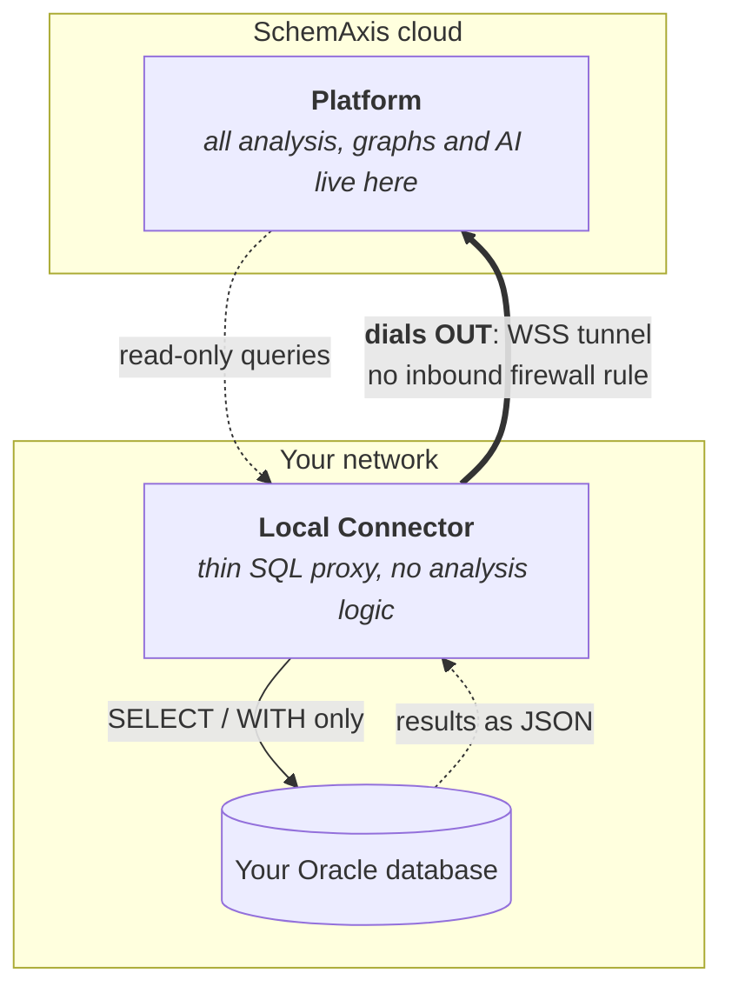

# SchemAxis Local Connector

A small Go program you run inside your own network so the SchemAxis platform
can read your Oracle database's **metadata** and answer impact, lineage and
documentation questions about it. It never reads business data, and it never
writes.

The agent is deliberately simple: it opens one outbound connection to the
platform, receives read-only queries, runs them against a database it can
already reach, and sends back the rows. All the analysis happens in the cloud,
so this program holds no analysis logic of its own. That is why its source is
public: there is nothing here to hide, and a database owner should be able to
read exactly what runs next to their database before they trust it with a
connection.

**Installing and running it:** [INSTALL.md](INSTALL.md) is the guide for the
person setting the agent up. Start there.

## How it works



1. The agent dials **out** to the platform over a TLS WebSocket (`wss://`). No
   inbound firewall rule is needed, and no port is exposed.
2. It receives read-only SQL from the platform.
3. It runs each statement against your Oracle database and returns the rows.

## Why it is safe to run next to a production database

These are properties of the code in this repository, not promises. Read the
files named and check for yourself.

- **It blocks writes.** Every statement is checked on your side of the
  connection before it runs: only queries (`SELECT`, `WITH`) get through, while
  statements that modify data or structure, row locks (`FOR UPDATE`), sequence
  increments and PL/SQL embedded in a query are refused. See
  [`internal/proxy/readonly.go`](internal/proxy/readonly.go) (`validateReadOnly`).
- **Defense in depth with a read-only account.** For the strongest setup, run
  the agent with a dedicated read-only Oracle account, as
  [INSTALL.md](INSTALL.md) shows. Your database then enforces read-only access
  as well, independently of the agent.
- **It only dials out, over TLS.** The agent opens the connection to the
  platform; the platform never opens one to you, and an unencrypted tunnel
  address is refused (plain `ws://` works only on the local machine, for
  development). See [`internal/tunnel/client.go`](internal/tunnel/client.go)
  and [`internal/tunnel/url.go`](internal/tunnel/url.go).
- **Your Oracle password stays on your machine.** Credentials are entered in the
  agent's local UI, encrypted at rest with a key generated on the same machine,
  and used only to open the local database connection. They are never sent to
  the platform. See [`internal/manager/crypto.go`](internal/manager/crypto.go)
  and the security section of [INSTALL.md](INSTALL.md).
- **It carries no analysis logic.** The queries arrive from the platform at run
  time; none are compiled into this binary. What you install is a transport.

## Build from source

You need a recent Go toolchain (see [`go.mod`](go.mod) for the version).

```bash
# Current platform
make build

# A specific platform
make build-windows
make build-linux
make build-darwin

# Everything, cross-compiled from one machine
make build-all
```

Or without `make`:

```bash
go build -trimpath -ldflags "-s -w" -o bin/db-agent ./cmd/agent/
```

A binary built either way reports its version as `dev`. To stamp one, run
`make build VERSION=1.2.3`, or add
`-X $(go list -m)/internal/branding.Version=1.2.3` to the `-ldflags` above.

The released binaries are built with `CGO_ENABLED=0`, so each is a single
static file with no runtime dependency. They are built by this repository's
own [release workflow](.github/workflows/release.yml), from the tagged commit,
and every release ships a `checksums.txt` and a signed build provenance
attestation for each archive. [INSTALL.md](INSTALL.md) shows how to check a
download against both. What changed in each release is in
[CHANGELOG.md](CHANGELOG.md).

## Changing the local web UI

The connection manager's page, [`internal/manager/web/index.html`](internal/manager/web/index.html),
is embedded in the binary and fetches nothing from a third party when it runs.
Its styles are Tailwind CSS compiled ahead of time into the `<style>` block, and
the markup uses arbitrary values, so do not edit that CSS by hand. After adding
or changing classes in the HTML, regenerate it:

```bash
# in a scratch directory, with Node available
npm install tailwindcss@3
# tailwind.config.js: darkMode 'class'; content -> the index.html path;
#   theme.extend.colors { darkBg:'#090d16', panelBg:'rgba(20,27,47,0.7)',
#   glassBorder:'rgba(255,255,255,0.08)' }; fontFamily.sans/mono -> system stacks.
# input.css: the three @tailwind directives.
npx tailwindcss -c tailwind.config.js -i input.css -o tailwind.css --minify
```

Then paste the output into the `<style>` block. The icons are Lucide glyphs
inlined as SVG: to add one, take its inner markup from the `lucide-static`
package (`node_modules/lucide-static/icons/<name>.svg`) and add it to the
`ICONS` map in the same file. Fonts are a system stack, so none is fetched.

## Repository layout

| Path | What it holds |
|---|---|
| `cmd/agent/` | Entry point, flag parsing, single-instance lock, browser launch |
| `internal/tunnel/` | The outbound WebSocket client and its reconnect logic |
| `internal/proxy/` | Oracle execution and the read-only statement check |
| `internal/manager/` | Connection profiles, local encryption, the local web UI, and the data directory with its migration after a rename |
| `internal/lockfile/` | The single-instance lock (an OS file lock on `agent.lock`), shared by the entry point and the data-directory migration |
| `internal/config/` | Per-connection settings and the `.env` loader |
| `internal/branding/` | Product name and the session-identification defaults |
| `scripts/` | Release tooling: `release-notes.sh` turns a CHANGELOG.md section into a release's notes |

## Reporting a security issue

Please report suspected vulnerabilities privately. [SECURITY.md](SECURITY.md)
says how.

## Contributing

The source is published so that anyone can read and build what runs next to
their database. This repository does not take code contributions:
pull requests and issues are turned off, and each release arrives here as a
single commit.

If you use the platform, report a bug through its support channel. Security
issues go to the address in [SECURITY.md](SECURITY.md), whoever finds them. The
license lets you fork the code and change it for your own use.

## License

Apache License 2.0. See [LICENSE](LICENSE) and [NOTICE](NOTICE). The product
name and logo are trademarks and are not licensed with the code.
